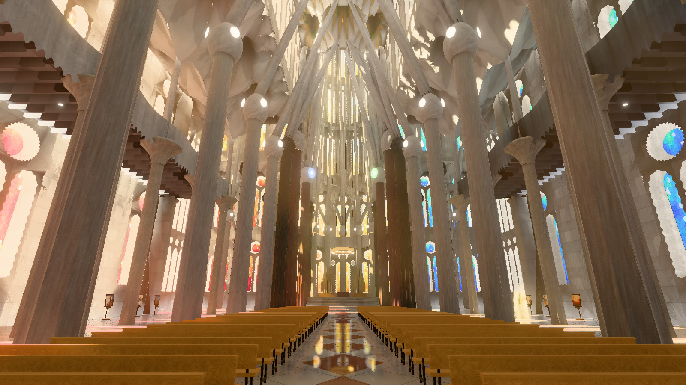
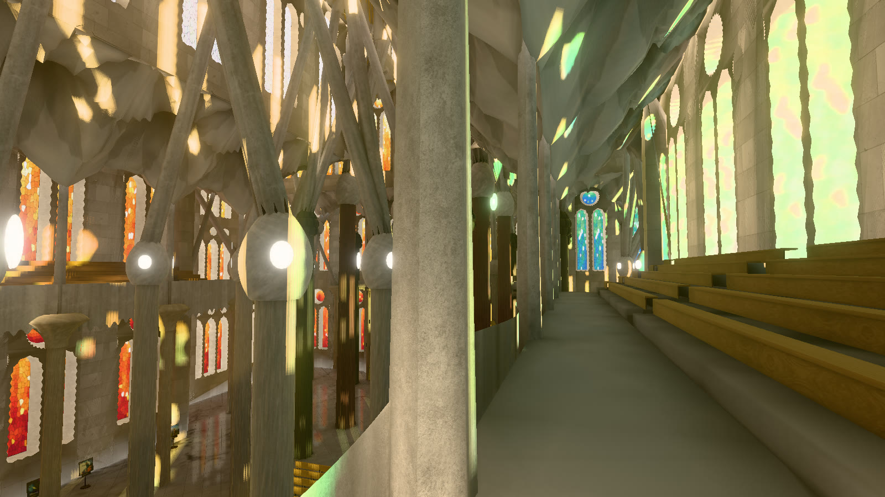
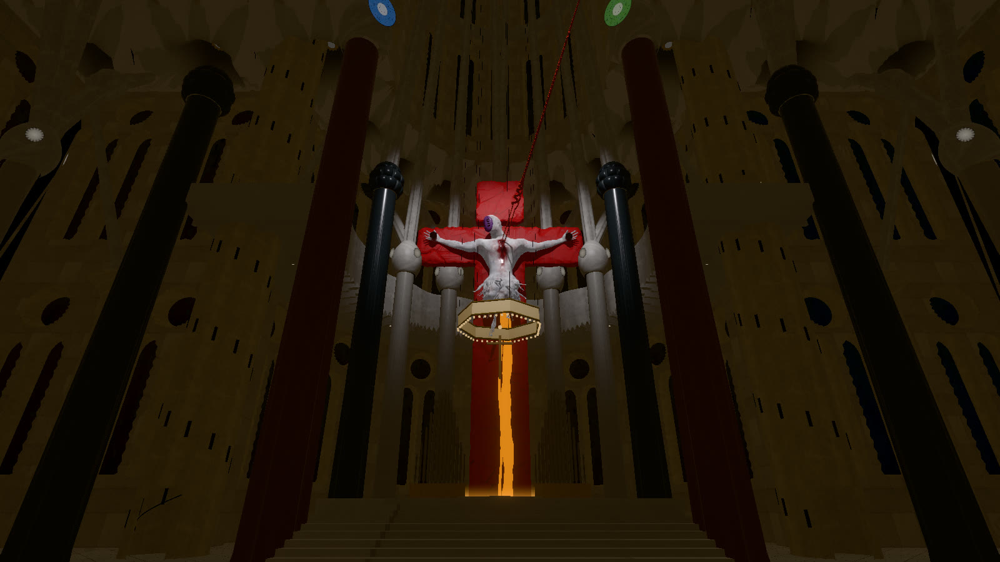

# Sagrada × Lilith

**Walk through the Sagrada Família as the sun crosses Barcelona, with your own music on the stands.**
Source-available and free for non-commercial use. Interface in English, 中文, 日本語 and Español.

A real-time recreation of the interior of Gaudí's basilica, built to its real measurements:

- **The light is the point.** The sun is computed for Barcelona at any hour and any day of the
  year. It falls through the stained glass in coloured patches that move across the floor and
  columns: blue–green from the Nativity side in the morning, red–orange from the Passion side in
  the evening. Light also bounces, through baked lighting computed in Blender.
- **Play a day:** ▶ runs the clock through 24 hours, or **Live** follows the real time in
  Barcelona.
- **Walk everywhere.** You can walk the nave and sit on the pews. Climb the spiral stairs to the
  choir galleries 15 m up, or fly up to the vaults.
- **Your music, in the basilica.** Choose a music folder, and its albums stand on bronze stands
  along the aisles. Play one, or carry its cover into the warm, cool or clear light falling at
  that moment. The nave reverb makes it sound like a church.
- **Built-in music:** if you haven't chosen a folder yet, a 1923 recording of the *Ode to Joy*
  (public domain) plays.

### Terminal Dogma (off by default)

An optional Evangelion layer: Lilith on her red cross behind the altar, pierced by the Spear of
Longinus, with the LCL running into a pool. With it on, the basilica turns into a stage at night.
The hall goes dark and a single light picks out the cross; from about midnight to 3:30 the church
is completely black except for her. Switch it on in **Settings › Terminal Dogma**.

## Run it

It runs on your own computer and works offline once installed.

1. Install **[Node.js](https://nodejs.org)** (version 20 or newer, the "LTS" one), which is free.
2. Download this project (**Code → Download ZIP** on GitHub) and unzip it.
3. Double-click the starter:
   - **Windows:** `Start Sagrada x Lilith.bat`
   - **macOS:** `Start Sagrada x Lilith.command` (if macOS refuses it the first time, right-click it,
     choose **Open**, then confirm)
   - **Linux:** run `sh "Start Sagrada x Lilith.command"` in a terminal
4. The first start installs what it needs (about a minute, once). Then your browser opens at
   <http://127.0.0.1:8770/>. Close the starter's window to stop it.

A graphics card helps: the basilica is about four million triangles with real-time sun shadows.
On laptops with integrated graphics, choose **Settings › Quality › Low**.

## Your music

Open the **Library** (Tab) and click **Choose music folder…**. Your computer's own folder window
opens; it may appear behind the browser. Pick the folder that holds your albums. It is scanned in
the background, and the covers then appear on the stands.

- **Album folders** become albums, with their cover art and tags.
- **Formats:** most audio formats work. Those a browser can't play (APE, WMA, …) are converted
  once as you play them, and CUE sheets are split into tracks.
- **Your folder is only read:** nothing in it is changed, moved or uploaded. The scan's results
  stay in the project's `data/` folder.
- **No folder window on your system?** Paste the folder's path instead. From a terminal, this works
  too: `npm run scan -- "/path/to/music"`.

## Controls

| | |
|---|---|
| **Click** the view, then the mouse | look around (Esc releases) |
| **W A S D** · **Shift** · **Shift Shift** | walk · hurry · sprint |
| **Space** · **C** | jump · crouch / prone (hold) |
| **E** | sit on a pew · play the cover you look at |
| **F** | fly (Space / C to rise / sink) |
| **Tab** · **[ ]** · **P** · **, .** | library · exhibition pages · play/pause · previous/next |
| **H** | help |

The **?** button shows everything, in your language (**EN / CN / JP / ES**, top right).

## For developers

- `npm start` serves it on port 8770 (`PORT=…` to change); `npm test` runs the tests.
- **Code:** `web/src/building/` builds the basilica from its plan (`plan.js`): columns, vaults,
  walls and glass, galleries and stairs. `web/src/render/` holds the lighting: sun and glass
  shadow maps, bounce light, the baked light, post-processing. `web/src/player/` holds walking,
  audio, the exhibition and the interface. Translations are in `web/src/i18n.js`.
- **Baked light:** after changing the building's geometry, re-bake it. Run
  `basilica.exportBake()` in the browser console, then
  `blender -b --factory-startup --python tools/bake.py -- 192` (about 7 minutes on an RTX 3070).
  If the geometry doesn't match, the app falls back to live bounce light.

## Licence and credits

The code and the project's own assets are © 2026 Pipbaby, under the
[PolyForm Noncommercial License 1.0.0](LICENSE). You may use, change and share them for any
non-commercial purpose. This is source-available, not "open source".

Third-party material keeps its own licence. In particular:
- the Lilith model is CC BY 4.0 (solodovnykov, modified);
- Evangelion is © khara, and this is a non-commercial fan work;
- the textures are CC0 (Poly Haven);
- the recording is public domain.

**See [CREDITS.md](CREDITS.md)** for everyone and everything this rests on, including the
photographers whose pictures guided the recreation.

Not affiliated with the Basílica de la Sagrada Família or with khara.
